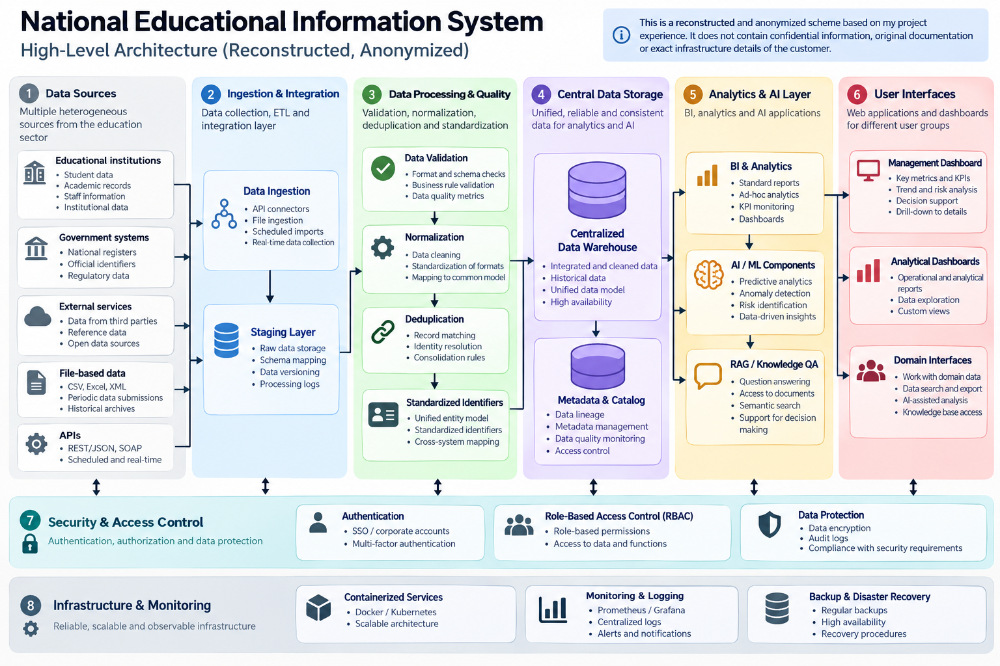

# National Educational Information System — Architecture Reconstruction

This repository contains an **anonymized and reconstructed high-level architecture diagram** based on my experience working on a National Educational Information System project in Thailand.

> **Important:** This diagram is not original customer documentation. It was reconstructed from my project experience for portfolio and architecture discussion purposes. It does not contain confidential information, source code, credentials, customer-specific infrastructure details, or proprietary datasets.

## Project Context

The project involved the development of a centralized information platform for the government education sector.

The system was designed to consolidate heterogeneous educational data, improve data quality and consistency, and provide a foundation for analytics, reporting, and AI-assisted data processing.

My work focused primarily on **system architecture, data integration and processing, data quality, backend/data components, and AI-related functionality**.

## High-Level Architecture

The reconstructed architecture illustrates the main concepts involved in the solution:

**Data Sources → Ingestion & Integration → Data Processing & Quality → Centralized Storage → Analytics / AI → User Interfaces**

### Data Integration

The platform integrated heterogeneous educational datasets through ingestion and integration pipelines.

The architecture included concepts such as:

- API and file-based data ingestion
- staging and intermediate processing
- integration of heterogeneous datasets
- scheduled data processing
- centralized data consolidation

### Data Quality and Standardization

A significant part of the system was dedicated to improving the quality and consistency of data before it became available for downstream analytics.

This included:

- schema and data validation
- normalization
- data cleaning
- deduplication
- entity matching
- standardized identifiers
- mapping data to a common model

These mechanisms helped consolidate records originating from different systems and organizations.

### Centralized Data Layer

Processed data was consolidated into a centralized data environment supporting downstream analytical and application workloads.

The architecture was designed around principles such as:

- consistent data models
- historical data processing
- reliable data access
- data quality control
- support for analytical workloads

PostgreSQL was among the technologies used in the project.

### Analytics and AI

The consolidated data could be used for BI, analytics, and intelligent data-processing scenarios.

My broader work around the platform included AI-oriented data processing and the use of modern Python-based AI tooling.

In related AI systems, I have also worked with:

- LLM applications
- RAG architectures
- Parent-Child chunking
- Hybrid Search
- reranking
- prompt engineering
- guardrails
- Ragas-based evaluation
- PydanticAI
- AI agents

These components are shown in the diagram to illustrate how AI capabilities can be positioned on top of a centralized enterprise data architecture.

## Infrastructure

My engineering work around enterprise systems includes technologies and practices such as:

- Python
- PostgreSQL / SQL
- REST APIs
- ETL and data-processing pipelines
- Docker
- Kubernetes
- microservices
- Prometheus
- Grafana
- cloud-native architecture

## My Role

I participated in the project as part of the engineering team rather than being the sole developer of the entire platform.

My responsibilities were primarily related to:

- architecture and technical design
- integration and processing of data
- data validation and quality
- backend/data components
- AI-related engineering
- technical decision-making

The diagram should therefore be understood as a **high-level reconstruction of the architecture and engineering concepts involved**, rather than an exact representation of every production component.

## Why This Diagram Is Public

The purpose of publishing this reconstruction is to demonstrate my approach to designing enterprise data and AI systems while respecting confidentiality obligations.

For that reason:

- organization-specific details have been removed;
- internal infrastructure details are not disclosed;
- datasets and identifiers are not reproduced;
- customer source code is not included;
- the architecture has been generalized and anonymized.

The diagram is intended for **portfolio, technical interview, and architecture discussion purposes only**.

## Disclaimer

This repository is an independent portfolio representation based on my professional project experience.

It is **not an official publication of the customer or project owner**, and the diagram should not be interpreted as original project documentation or as an exact representation of the current production infrastructure.
